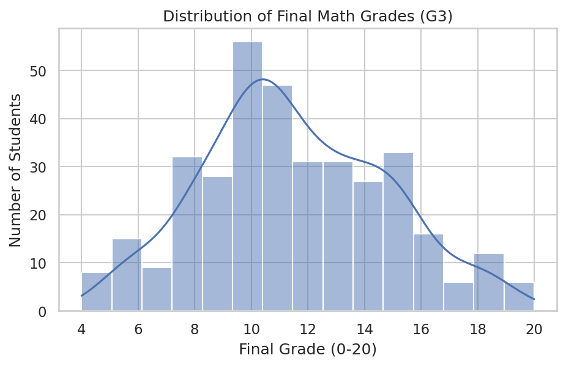
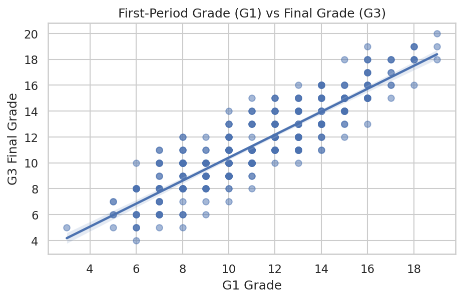
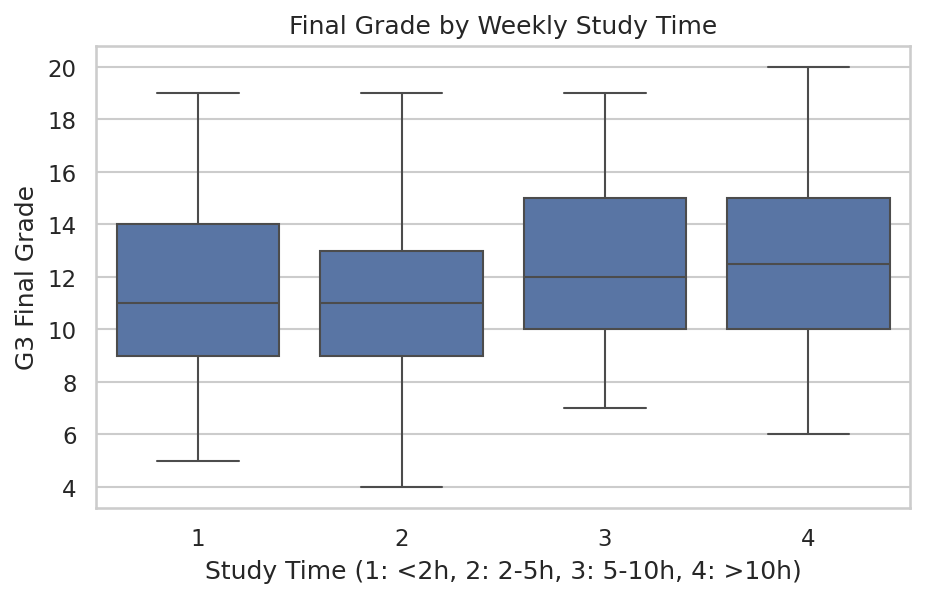
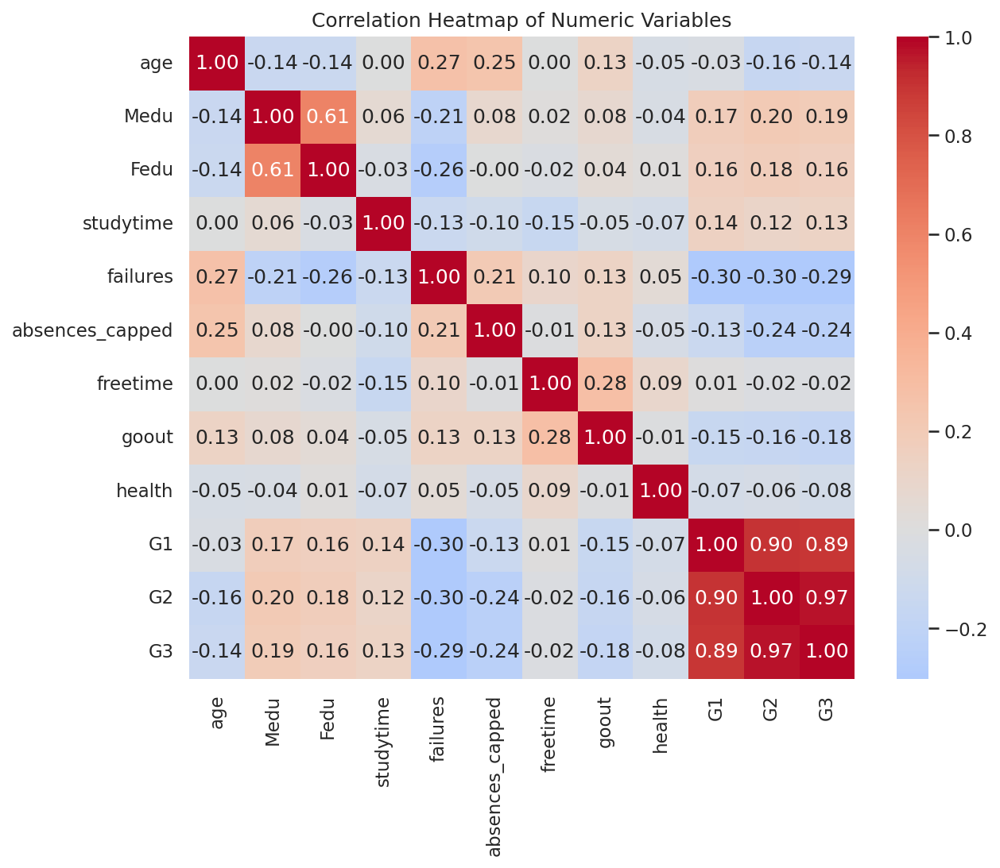

Final project for Python class at Mountain Land Tech.

[Open my notebook in Colab](https://colab.research.google.com/drive/11cJCiO4hU-we3aGR7IZHvwbSDETzMuyB?usp=sharing)

Dataset: Student Performance (UCI) https://archive.ics.uci.edu/dataset/320/student+performance

# Student Performance Analysis (Python)

## Dataset
- **Source:** UCI Machine Learning Repository, *Student Performance* dataset (https://archive.ics.uci.edu/dataset/320/student+performance)
- **Files used:** `student-mat.csv` (395 students, 33 columns) and `student-por.csv` (649 students, 33 columns). Both files are in this repo.
- **Contents:** Data from two Portuguese secondary schools, including grades (G1, G2, G3), study time, absences, past failures, family background, and lifestyle survey answers. G3 is the final grade on a 0-20 scale.

## Motivating Questions
1. What factors are linked to a student's final math grade (G3)?
2. Do study time, absences, and past failures matter?
3. Do students who want higher education score differently from those who don't?

## Steps Taken

### 1. Ingestion
Loaded both CSV files with `pandas.read_csv()` using `sep=";"` because the files are semicolon-separated.

### 2. Cleaning
- Checked for missing values: **none found**.
- Checked for duplicate rows: **none found**.
- Converted text columns to the `category` data type.
- Found **15 absence outliers** with the IQR rule (Q3 + 1.5 x IQR) and **capped** them instead of deleting students, so no data was lost.
- Removed **38 students with G3 = 0**, who likely skipped the final exam. This left **357 rows** (395 -> 357).

### 3. Manipulation
| Operation | What I did | Why |
|---|---|---|
| Sorting | Ranked the top 10 students by G3 | To see what the highest performers look like |
| Filtering | Kept students who want higher education | To compare groups for the t-test |
| Grouping | Averaged G3 by study time level | To see whether more study time leads to higher grades |
| Merging | Joined math and Portuguese data (382 students are in both) | To explore students who took both classes |

### 4. Visualization
Four charts made with Matplotlib and Seaborn (below).

### 5. Statistical Analysis
Descriptive statistics, correlation analysis, and a Welch's t-test.

## Key Figures

### Distribution of Final Grades

Grades are roughly bell-shaped and peak around 10. Few students score 16 or higher.

### First-Period Grade vs. Final Grade

G1 and G3 follow a tight upward line, so early grades strongly predict final grades.

### Final Grade by Study Time

Median grades are about 11 for study time levels 1 and 2, and about 12 to 12.5 for levels 3 and 4. The boxes overlap heavily, so the effect is small.

### Correlation Heatmap

## Statistical Results

**Descriptive statistics (G3, n = 357):** mean = 11.52, median = 11, mode = 10, standard deviation = 3.23.

**Correlation with G3:**
| Variable | r |
|---|---|
| G2 | 0.97 |
| G1 | 0.89 |
| Medu (mother's education) | 0.19 |
| Fedu (father's education) | 0.16 |
| studytime | 0.13 |
| absences (capped) | -0.24 |
| failures | -0.29 |

**Welch's t-test (wants higher education vs. does not):** t = 3.51, p = 0.0028. Because p < 0.05, the difference is statistically significant: students who want higher education score higher.

## Key Insights
1. **Earlier grades are the best predictor.** G1 (r = 0.89) and G2 (r = 0.97) are very strongly linked to G3.
2. **Past failures and absences go with lower grades.** Failures (r = -0.29) and absences (r = -0.24) show weak-to-moderate negative links.
3. **Study time has a small effect.** Its correlation is only 0.13, and the boxplot distributions overlap heavily.
4. **Educational goals matter.** Students who want higher education score significantly higher (p = 0.0028).
5. **Parents' education is weakly positive** (Medu 0.19, Fedu 0.16), and the two are correlated with each other (0.61).

## Limitations
- Correlation does not prove causation.
- Only 14 students said they do *not* want higher education, so the t-test result should be treated with caution.
- Removing G3 = 0 students means the analysis does not cover students who skipped the exam.

## How to Run
1. Open the notebook in Google Colab.
2. Upload `student-mat.csv` and `student-por.csv`.
3. Run all cells in order.

## AI Citation
AI assistance: Claude (Anthropic) was used to help structure the code and this README. I ran and reviewed all code and results.
